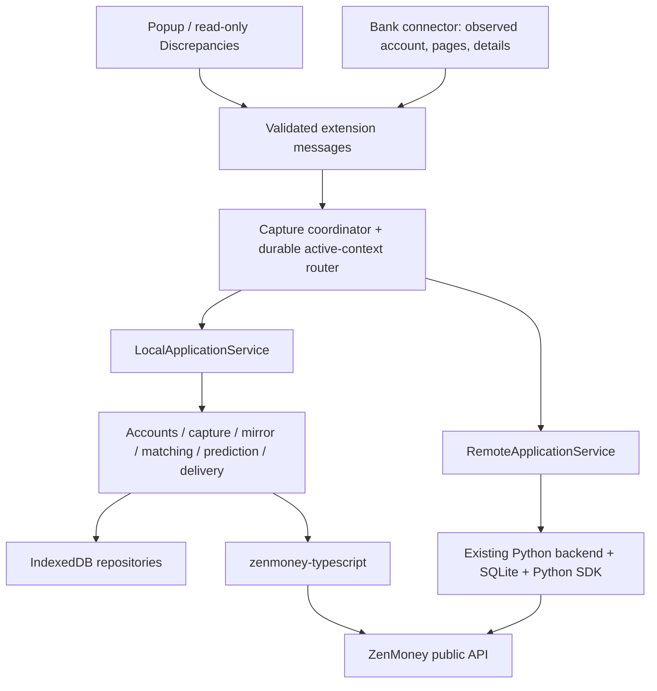

# Standalone runtime architecture

Status: proposed architecture for Phase 2. Product decisions are listed in
[README](README.md); stages are in the [execution plan](implementation-plan.md).

## 1. Boundaries and repository ownership



The active-context router selects exactly one service. There is no dual-write
arrow and no local fallback when a configured server cannot be reached.

The API SDK remains general purpose. Do not add banks, migration, Chrome storage,
application UUID policy or category learning to it.

Backend changes are limited to portable import/export, capability/identity
reporting and recovery support, plus a separately reviewed defect if parity tests
find one. The Python backend remains independently deployable.

Suggested internal extension layout (adjust filenames consistently during L0):

```text
src/application/        application service interface, local/remote adapters, DTOs
src/domain/             pure bank identity, periods, reconciliation, learning, reports
src/local/storage/      Dexie schema, repository operations, invariants, generations
src/local/zenmoney/     SDK gateway, mirror projection, exact DTO conversions
src/local/jobs/         durable scheduler, outbox, writer fences, crash recovery
src/local/migration/    portable codec, staging and archive validation
src/control/           active mode, cross-mode migration and switch state machine
src/runtime/            bootstrapping, trusted RPC, active context and credentials
contracts/business/    versioned fixture schema, expectations, behavior matrix
tests/domain/           pure TypeScript behavior
tests/storage/          repository and migration invariants
tests/browser/          real IndexedDB + built MV3 extension
```

Existing `extension/connectors/`, popup and report markup remain entry points.
Convert only touched JavaScript boundaries as needed; a repository-wide TypeScript
conversion is not a prerequisite. The build emits a standalone `dist/extension`
with bundled dependencies and existing connector injection files.

## 2. Application service contract

Replace UI/coordinator construction of `new Backend(...)` and string routes with
typed application operations. `RemoteApplicationService` translates those
operations to the current HTTP v1 API. `LocalApplicationService` executes the same
validated behavior using repositories. Do not build a localhost HTTP server inside
the extension or implement a second string-path router for local mode.

Inventory at minimum:

| Group | Operations and guarantees |
|---|---|
| Runtime | capabilities, active mode, storage identity, readiness, redacted errors |
| Connections | list/discover, get, rename; automatic account-anchor detection |
| Accounts | catalog, configure/ignore with optimistic settings version |
| Capture | start(idempotency key), get job, acquire/renew lease, ingest page, finish interval, pause, stop |
| Reporting | both unmatched sides, coverage/freshness, capture/delivery counters, last successful timestamps |
| Migration | status, prepare/export, staged import, query/cancel transfer, explicit source resume |

Preserve idempotency/error semantics from `backend/sync_contracts.py`, including
replaying the same start command after an unknown acknowledgement. A known paused
job requires a new resume command; an unknown job keeps its original request ID.
Do not reuse the historical copied `docs/sync-api-v1.md` as the sole current schema:
generate the contract inventory from the current backend definitions and routes.

Chrome messages contain plain JSON-compatible DTOs only: no `BigInt`,
`ExactDecimal`, File/Blob, token-bearing client objects or database handles.
The token configuration command is privileged and excluded from logs; status
responses never echo a saved secret. Financial DTOs use decimal/ID strings.

## 3. Active context and upgrade behavior

Persist control state in IndexedDB, separate from portable financial records:

- `datasets`: dataset ID, generation, source lineage, lifecycle/hold state,
  financial activity marker, logical schema version and expected owner IDs.
- `runtime`: active mode, active local generation or remote endpoint/instance,
  epoch, credential reference, pending switch ID.
- `switches`, `imports`, `exports`: durable command and transfer journals.
- `leases`: holder, fencing epoch, expiration; scopes include active writer,
  capture account and migration.

All local stores include dataset/generation scope in their keys. One IndexedDB
database permits the active-generation pointer and switch outcome to commit in
the same short transaction. A second database for staging would lose that atomic
activation boundary and is not the default design.

Verified credentials persist in trusted `chrome.storage.local`, referenced by
opaque credential IDs, so restarting Chrome does not require another token paste.
Unverified secret drafts use trusted `chrome.storage.session` with a 24-hour TTL:
they survive popup/worker closure but not a browser session restart. Clear them
after save, explicit cancellation, token removal or expiry. Endpoint drafts may
persist separately without containing a token.

No attempt is made to atomically commit across Chrome storage and IndexedDB: save
the verified candidate secret first, then commit its reference/credential epoch.
A missing referenced secret blocks activity on recovery. Removal first durably
disables the credential epoch and prevents new claims/dispatch, then deletes the
secret and drafts; never delete financial data or the loss-detection sentinel.
Rotation/removal races obey the same quiescence/dispatch gate as mode changes.
Already transmitted requests remain recorded and may become uncertain; token
removal cannot retract them. Same-owner rotation verifies original UUIDs using
the new context without mutating attempted payloads.

Maintain a separate nonsecret `localDatasetSentinel` in trusted
`chrome.storage.local`: installation ID, original anchor lineage/generation,
initialization state and whether financial activity may have started. Persist and
acknowledge it **before** initializing a writable financial dataset or dispatching
any local write. It survives token removal and mode switches. A crash between
sentinel creation and IDB initialization enters explicit setup/recovery; it cannot
silently claim to be a new installation. IDB-only control state cannot detect its
own disappearance. Clearing both extension stores or uninstalling is outside this
detection guarantee and requires a user backup.

The original anchor header is retained permanently. Root and per-generation
participant state select the actual writer atomically inside IDB; the sentinel
never becomes a second active-generation pointer. See [ADR 004](adr-004-immutable-recovery-anchor.md).

Boot rules:

1. Existing `config.url`/token with no mode metadata becomes **remote**, preserving
   jobs and drafts. An update must never connect that user directly to ZenMoney.
2. A genuinely new installation initializes **local, unconfigured**.
3. A durable marker indicating a former local dataset plus a missing/corrupt
   database means recovery-required; never silently initialize an empty journal.
4. A pending switch resumes its state machine before any new writer starts.
5. A retained inactive generation is read-only. A server outage does not select it.
6. Cache keys, drafts, job progress and profile hints include storage identity and
   active epoch, not only server URL or bank name.

Expose a compact `Local`/`Server` status in the popup. Do not show implementation
IDs unless needed in exported diagnostics.

## 4. Exact values, identities and persistence

Use the SDK's lossless `decodeJson`/`encodeJson` at ZenMoney wire boundaries.
Persist the original wire JSON and attempted transaction payload text unchanged.
Projection data and Chrome DTOs use strings.

`ExactDecimal` provides exact representation/comparison, **not arithmetic**.
Implement a small pure money module for the backend's fixed finite domain:
canonical decimal strings; integer coefficient with `BigInt`; aligned scale;
exact addition/subtraction/comparison. No `Number`, floating rounding, tolerance
matching, or implicit conversion. Bank amounts retain the existing maximum
24 integer / 12 fractional digits, positive amount + separate direction.
For remote projections, define bounded exponent expansion and magnitude limits
from backend behavior; reject unprojectable values explicitly while retaining raw
evidence. Never turn a parse failure into zero.

Use string identity keys in IndexedDB and DTOs; do not use bigint as an IDB key.
Integer IDs/cursors outside JavaScript's safe range are preserved as decimal
strings and converted explicitly to SDK `bigint` when needed. Timestamp conversion
checks range and never narrows a cursor silently.

Maintain distinct identities:

- Canonical physical bank account: existing bank/identity-scope/profile/source-key/
  currency tuple; owner display names are not identity.
- Bank operation UUID plus bank external identity, aliases and immutable versions.
- ZenMoney transaction UUID and **actual account side** used by its match.
- Dataset lineage, installation/backend instance, active generation and switch ID.
  Source `service_meta.instance_id` has historically traveled with exports; do not
  suddenly use it as an unforgeable physical endpoint identifier.

IDB unique indexes cover canonical identities and claims. Relations, append-only
history and state-transition restrictions are validated inside the same repository
transaction. Raw Dexie table access is private to storage modules. Matching/delivery
may not bypass repository methods.

No network call, timer, crypto digest, or arbitrary promise runs inside an IDB
transaction. Prepare/hash outside, then revalidate the input version/generation and
commit a bounded transaction. Catching an invariant error must not commit half a
mutation. Use strict durability where supported for intent/activation commits;
L1 measures actual browser behavior rather than equating a resolved promise with
guaranteed survival of power loss.

## 5. Chrome runtime and scheduling

The service worker owns the financial engine. The popup is a controller and view;
closing it does not cancel an already authorized sync. Connector messages can
advance capture only for the expected tab/document/account/run/lease.

Store jobs, pages, read cursors, attempt states, backoff, epoch and import checkpoints
before acknowledging progress. Register listeners synchronously at worker startup.
On startup/wake, reconstruct pending work and recreate missing alarms. Alarms
resume authorized work; they never initiate a new bank import without a click.

Treat every asynchronous boundary as a possible worker termination:

- A page is acknowledged only after records + page digest + checkpoint commit.
- Completed coverage requires validated totals, all pages and required details.
- A network write starts only after an immutable intent transaction commits.
- An `attempting` record after restart becomes verification-only `uncertain`.
- A stale callback cannot update the currently active dataset after an epoch change.

Serialize mirror reads and writes that exchange a ZenMoney cursor. Use a durable
lease/fence plus short atomic claims. An in-memory promise queue is an optimization,
not mutual-exclusion evidence. An expired lease cannot release an uncertain write
for retransmission. Concurrent popup/report/alarm requests must exercise the same
gate. Network responses may reconcile the old intent only within its own
dataset/generation; stale work cannot create a new intent.

Use bounded work slices, indexed queries, per-account/day matching and checkpointed
staging. The default direct SDK deadline should be explicitly set to **20 seconds**
(its general SDK default is 60 seconds). Preserve a finite response limit, initially
64 MiB, and measure parse/memory cost at L1/L12. Never invent diff pagination that
the public API does not provide. An oversize/slow account produces a useful blocked
state and can use backend mode; do not advance its cursor on incomplete data.

Chrome shutdown stops local execution. Restart resumes already authorized work;
bank capture requires a still valid or newly reopened bank session. No heartbeat,
hidden page, debugger or bank keepalive may be used to defeat worker lifetime.

## 6. ZenMoney identity and mirror

Read/write through the published npm SDK, bundled locally. Request only the exact
ZenMoney API origin needed by the package (verify the package origin in L1).
Never expose a general-purpose authenticated URL fetcher to bank/content scripts.

Token setup is explicit. Read-only bootstrap establishes the current user/owner ID
set, validates the catalog and binds it to the local dataset. First-time account
selection requires this successful read. A replacement token for the same verified
identity is allowed; another identity is blocked from using an existing financial
journal. Token hashes are runtime credential bindings, not portable owner identity.

Mirror parity requirements:

- All supported SDK entity kinds, unknown fields and original raw JSON are stored.
- Full refresh replaces only explicitly returned full collections; missing objects
  do not prove deletion. Required bootstrap collections must be present.
- Apply raw response, projections, explicit tombstones and cursor in one atomic
  visible generation. Large responses may use a staging generation and atomic
  publication, never a cursor committed ahead of data.
- Enforce expected cursor/generation/source; discard stale response application.
- Confirm a previously attempted UUID by existence even if the mobile app changed
  its fields. Never correct it back to the sent payload.
- Explicit deletion suppresses the related bank operation permanently; retirement
  of an old duplicate does not suppress a separately retained canonical original.
- After migration, reset freshness and force a full read. Preserve all tombstones,
  receipts and uncertain intents across this reset.
- A failed refresh marks the mirror stale; cached data must not be labeled current.

Mirror snapshot generations are distinct from whole-dataset migration generations.
Publishing a staged mirror cannot replace bank/outbox/control records captured
while it was being read. Its commit checks the expected dataset epoch and mirror
cursor, then atomically exposes the new mirror pointer/projections and related
deletion facts. Repository readers resolve that pointer consistently.

The backend currently has a 300-second catalog freshness bound, bounded read
retries and durable retry scheduling. Port exact behavior through fixtures;
do not independently tune it in the browser during the initial phase.

## 7. Capture, connections and periods

Reuse BIDV/VietinBank connectors, selectors, parsers, limits, pagination and details
rules. They still supply observed data, not trusted financial decisions.

Retain automatic connection detection by known accounts/primary account, labels
with inline rename, multiple logins to one bank, and shared canonical physical
account history. Current primary-account detection limitations remain documented.
Do not infer a new connection from owner name alone.

Account settings retain `enabled`/`ignored`/`unconfigured`, same-currency active
ZenMoney targets, optimistic version checks and historical bindings.
Started/uncertain payloads cannot be remapped. Unsupported/new accounts do not
block configured supported accounts.

Preserve initial 30-day default with six-month and custom-start options. Preserve
the popup's synchronization-period overrides and the backend's ordinary
last-complete-boundary minus 14-day overlap, filling known gaps first. L0 records
exact precedence of the existing popup override versus incremental planning;
the port must not silently reinterpret a default as a mandatory full reload.
Use each bank's IANA timezone for days and current date, not UTC date slicing.

Port complete page/body validation, replay digests, details evidence, leases,
immutable captured revisions, empty interval evidence and delivery authorizations.
An incomplete capture cannot produce delivery authorization or false coverage.

## 8. Matching, transfers, predictions and reports

Matching is a business engine, not a query that merely tests whether a UUID exists.
Port the backend's current semantics with explicit reasons:

1. Respect terminal processing and permanent identities first.
2. Try bank-reference matches with actual target side/currency/amount/day.
3. Match signed movement on the target account across **all transaction types**.
4. Preserve multiplicity for repeated equal day/amount values; deterministic order
   does not establish payee/category identity.
5. Support existing unique split/settlement groups. Retain 16-part and 20,000-visit
   bounds and the backend's ambiguity/exhaustion policy.
6. Occupancy is per `(ZenMoney UUID, actual target account)`: a transfer can serve
   one bank operation on each side, including FX legs with different amounts.
7. Do not require the other transfer account to be synchronized. When a new bank
   arrives, recompute candidates and corroborate unresolved legacy ownership only
   with the backend's required original/opposite-leg evidence.
8. Keep immutable proven targets. Current remapping alone cannot rewrite historical
   ownership. Unknown ownership blocks only the affected scope, with a useful code.
9. No automatic remote conversion of two expenses/incomes into a transfer and no
   automatic deletion of suspected duplicates are added by this phase.

Remaining ordinary ambiguous records follow the user's prior policy: new
unreviewed records may be created. An uncertainty about a **previous write** is
different and must never be treated as a new record.

Category parity: eligible manual choices/rules already present in history, then
three independent consistent reviewed examples, otherwise null. No new editor is
added. Unreviewed predictions, chronological duplicate ties, ambiguous claims,
settlements and unsuitable transfers cannot become training evidence. Rebuild
evidence after relevant mobile changes or new bank relationships. ZenMoney may
still assign a category remotely; a null local prediction cannot promise to disable it.

The Discrepancies report reads complete bank coverage and the mirror independently
of delivery outcome. It compares current values even for previously linked IDs,
includes both bank-only and ZenMoney-only candidates, and does not infer correctness
from a zero net daily difference. Read-only refresh never calls upsert/delete.
Reuse UI and exact-string totals through the application service.

## 9. Delivery and unknown outcomes

State model: `pending → prepared → attempting → delivered | uncertain`;
explicit remote deletion yields `suppressed`. Terminal states cannot return to
pending. Preserve bank_processing and delivery-specific states separately.

For every batch (maximum 20, matching the backend):

1. Check active mode/epoch, source hold, owner identity, current settings and
   complete captured-version authorization.
2. Fetch a fresh mirror outside the DB transaction; resolve known IDs, tombstones,
   matching and eligible prediction before choosing still-new records.
3. Prepare one stable UUID and exact payload per new bank operation. Use bank
   occurred time for `created`, current time for `changed`, correct sign/account/
   currency and `viewed=false`. Persist source revision and actual target.
4. Atomically claim records and persist immutable attempt intent **before** fetch.
   Failed persistence means no request.
5. Send once through the SDK. It has no hidden write retry.
6. Apply the response/mirror and journal atomically if still valid. If interrupted,
   malformed, partially applied, timed out, rejected by HTTP or lost: retain the
   original UUID/payload and mark unresolved items verification-only.
7. A later read confirms existing IDs or explicit tombstones. Absence after any
   wait is not proof that a second write is safe. Do not reset UUIDs/attempt flags.

Partial batch success remains partial; counters do not hide uncertain remainder.
Reads can retry with persisted backoff (currently 15/30/60/120/240/300 seconds).
One blocked account/day must not prevent unrelated safe scopes from completing.
Stopping capture and pausing the entire source are distinct operations.

## 10. Mode switch state machine

Persist a command ID and the phases:

`requested → destination_checked → source_quiescing → source_paused →
export_ready → importing → destination_verified → source_handed_off →
active_pointer_committed → destination_activated → complete`.

Failed/unknown phases retain enough source/destination IDs, archive digest and
receipt data for a read-only status check. Each step is idempotent. Before commit,
the old context is still selected but may be paused; after commit, only the new
context is selected. At neither point does absence of a UI acknowledgement permit
both writers to run.

### Participant state and activation authority

An extension-side `activeMode` flag is insufficient: the backend can execute
delivery independently or accept a command from another browser.

The format-2 participant protocol therefore has durable, compare-and-swap
transitions, keyed by `switch_id`, installation ID, dataset digest and expected
participant epoch:

- Source: `active → export_hold → handed_off`, or
  `export_hold → cancel_pending → active`.
- Destination: `empty → import_hold → armed → activated`, or terminal `discarded`.
- `armed` means the import/identity checks passed; it still cannot send.
- Only the coordinator can request activation using the matching handoff receipt.
  First make `source_handed_off` durable, then select the destination, then activate
  it. The selected context stays read-only while activation is unresolved.
- `activated` permits a subsequent explicit Synchronize; it does not itself start
  delivery. The source stays handed off and cannot resume a queued capture.
- Lost acknowledgment queries the same transition/session, never starts another.
  Replayed commands with stale epoch, different digest or a discarded session fail.

The current backend's `/jobs` removes an `imported` hold, and legacy
`/migration/resume` removes an `exported` hold. L3 **must guard these paths**:
neither command, nor account settings, mirror refresh, worker startup or a legacy
client may clear a format-2 hold or handoff. Unmigrated ordinary remote behavior
remains compatible; a legacy client on a held dataset gets an explicit migration
status/error. This is a required backend change, not a UI convention.

Before the irreversible handoff, cancellation first wins a **source-side** CAS
from `export_hold` to `cancel_pending`, competing with the transition to
`handed_off`. Only its durable receipt permits destination `discarded` (or a
verified no-import result), invalidating delayed activation commands. Then it
resumes the source from `cancel_pending` with matching hold ID and epoch. A lost
decision reply is resolved by source status before discarding anything. If handoff
won, discard is forbidden. This prevents a stranded handed-off source paired with
a concurrently discarded destination. After `handed_off`, there is **no in-place
rollback**: recover forward, or
perform a new explicit reverse migration from the current destination. This
avoids reactivating an out-of-date source after the destination might have changed.

The coordinator verifies participant receipts through their authenticated status
commands and binds them to the same operation. They are not authentication secrets.
The threat model covers crashes, stale/reordered commands and ordinary concurrent
clients; a malicious administrator with write access to both databases is outside
the protocol's guarantee.

### Local → fresh server

In Server connection, offer **Move local data to this server** when applicable,
checked by default if local history exists. Check destination capabilities,
emptiness and owner identity before pausing the source. Quiesce capture/writes,
persist the hold, export all portable state, import/verify the digest, then switch
the active context. Imported delivery remains on hold until explicit Synchronize.

Do not accept “fresh” based only on a count of transactions. A failed/empty first
job or imported delivery journal makes a target used. Check eligibility again
inside the import commit.

If the user disables transfer to an empty server despite existing local history,
show a specific confirmation that processing/deletion history will not travel.
Keep a recoverable inactive copy and do not start synchronization as part of Connect.
The safer default is transfer; silent loss of deduplication evidence is prohibited.

### Join an already used server

Verify access/capabilities and owner identity. Hide/disable migration with an
explanation. If local history exists, explain that it remains inactive and is
not uploaded. Quiesce local work and switch only after explicit confirmation.
Do not pause the shared destination server. Local token is not sent to the server.

### Server → local

The local ZenMoney token is supplied and verified separately. The server must
export a quiescent current archive; this pauses that server for **all** browsers,
which the confirmation states.

Import into a new empty local generation. If an old local generation exists,
provide a backup/export step and explicit **Replace inactive local copy** confirmation;
never merge or resume the stale copy. Publish the new generation atomically.
Retain the prior generation read-only until the user has a verified backup and a
separately confirmed cleanup. Cancel preserves it.

A server that cannot be reached cannot provide a current reverse migration.
Retained local history may be inspected/exported, but must not automatically
become a writer.

### Recovery rules

- Lost import reply: query transfer ID/digest; do not re-import another file.
- Import succeeded, activation failed: both source and imported destination stay
  on hold; recover the pointer commit from durable receipts.
- Cancellation before source handoff: source resume is explicit and requires a
  durable source `cancel_pending` decision followed by verified terminal
  destination discard/no-import outcome. If either outcome cannot be checked,
  remain paused.
- After source handoff: finish the same activation or plan a new reverse migration.
  Never resume the old source in place, even if the destination appears idle.
- Normal settings never override migration holds. Re-entering the same URL is not
  a source-resume command.

This coordinates reachable participants. It cannot prevent someone deliberately
running an older disconnected copy; the UI must not claim a global distributed lock.

### Archive-only disaster recovery

Live migration and restoring a saved backup are separate operations. A backup
may have been exported while its source later resumed, or the source profile may
no longer exist. It cannot supply a valid current handoff receipt.

Offer explicit **Restore backup** only into an eligible empty destination/fresh
local generation. Require confirmation that all former writers using that dataset
have been retired and will not resume. This is a user declaration, not technical
proof of global exclusion. Never invoke it automatically because a server is
offline, and never label it a completed current-data migration.

Validate archive/owner, preserve all attempted/deleted evidence, refresh the full
mirror and show a read-only reconciliation summary before the next explicit sync.
The restored context remains held until that deliberate activation. Retain original
archive provenance plus a new recovery-operation/installation identity.

Explain that records/receipts/deletions learned after the snapshot may be lost:
no backup can reconstruct an unrecorded later decision, and zero-duplicate
guarantees extend only to preserved evidence. If the current source is still
available, prefer live migration. Old source data must not be merged back later.

## 11. Minimal UI, privacy and permissions

Keep the existing popup and one read-only report page. Suggested order:

1. Product/current bank connection with rename; small active storage indicator.
2. Synchronize, collapsed Synchronization period, progress + last successful sync.
3. Discrepancies.
4. Collapsible Bank accounts.
5. Collapsible ZenMoney connection (local mode); open when setup is required.
6. Collapsible Server connection (optional), with mode-switch/migration controls.
7. Collapsible Data migration, applying to the selected storage.

Fields persist drafts across popup closure. Configured sections start collapsed.
No bank UI toggle, token echoed in status, transaction editor or bank-login fields.
Connection names and saved drafts are scoped to the active dataset.

L1 found that Chrome rejects optional `unlimitedStorage`, despite a migration-doc
example suggesting otherwise. Declare `unlimitedStorage` as a required manifest
permission; request only the exact API host through a setup user gesture. See
[ADR 001](adr-001-chrome-storage-permission.md). If API host access is
declined/revoked, local readiness is blocked; server mode
remains usable. Monitor quota/write errors anyway: physical disk exhaustion and
uninstall are not solved by that permission. No silent data pruning of journals.

Use trusted-context storage access, narrow RPC sender/origin/document checks,
strict input bounds, existing CSP, packaged code and no embedded OAuth client secret.
A bearer token is stored locally; explain this once in setup. Encrypting with a key
stored next to it is not claimed as extra protection. Do not sync tokens/financial
history through `chrome.storage.sync`. Private/incognito local operation is out of
scope and must be explicitly blocked rather than sharing ambiguous datasets.

## 12. Primary documentation consulted

Accessed 2026-10-20; recheck exact dependency versions at L1.

- [Chrome service-worker lifecycle](https://developer.chrome.com/docs/extensions/develop/concepts/service-workers/lifecycle):
  worker termination and durable recovery requirements.
- [Chrome extension storage](https://developer.chrome.com/docs/extensions/develop/concepts/storage-and-cookies):
  IndexedDB access, origin scoping, quota/eviction and unlimitedStorage.
- [Chrome cross-origin requests](https://developer.chrome.com/docs/extensions/develop/concepts/network-requests):
  host permissions and content-script security boundary.
- [Chrome alarms](https://developer.chrome.com/docs/extensions/reference/api/alarms):
  recreate missing alarms; do not rely on newer-only persistence flags at Chrome 120.
- [Dexie transaction guidance](https://dexie.org/docs/DexieErrors/Dexie.PrematureCommitError):
  external asynchronous work outside database transactions.
- [SQLite browser persistence options](https://sqlite.org/wasm/doc/trunk/persistence.md):
  alternative architecture constraints, not a selected dependency.
- [SDK boundary design](https://github.com/vaslv/zenmoney-typescript/blob/v0.1.0/docs/extension-boundary.md):
  approved product decisions and separately required live-extension feasibility.

The proposed architecture and performance budgets are design decisions. These
sources do not constitute implementation, durability or live API acceptance.
